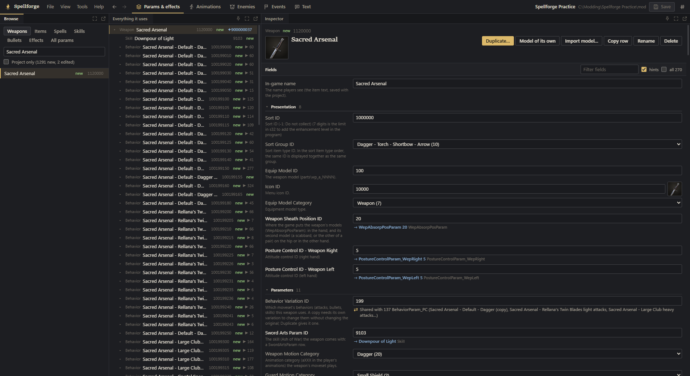

# DISCLAIMER

Due to the community feedback and request, I am publishing this tool in a non finished state. Yes this tool is vibe coded, 
so do what you will with what you got here. Considering the responses I Have gotten even posting that I was working on this tool, I
will no longer be updating this unless the community accepts it. This build of Spellforge has not been tested, and I am not confident
in the state that it is in at the moment. All the tutorial videos are AI generated and placeholders, the plan was to remake them myself
or have someone who was interested in showing the tool. As of right now, all future production of Spellforge is halted. If someone decides 
too pick this up and build upon it, potentially without AI, I would be nothing but happy. Goodluck, and happy modding.


# Spellforge

A Windows desktop editor for Elden Ring mods: weapons, spells, skills, bullets, effects, animations, behaviour scripts
and every param. It reads the game straight from its Steam install, with nothing to unpack, and writes only into a
ModEngine project's `mod` folder.



## What it does

- **Params:** all 194 param tables, with English field names and descriptions, enums, icons and references to follow.
  **Duplicate** a weapon, spell or skill with everything it owns under safe new IDs, or **Scale** a skill's effects and
  hitboxes together.
- **Effects:** recolour, swap textures and models, edit any field, and preview the effect lit by the game's own light
  probes.
- **Animations:** DS Anim Studio-style event editing on a timeline, and a 3D viewer that plays animations with armour,
  weapons, hitboxes, bullets, effects and sounds. New animations are registered in the behaviour graph so the game plays
  them.
- **Movesets and behaviour scripts:** give a weapon other weapons' moves, spells as its attacks or another class's
  stance; edit the player's behaviour script with recipes (custom combos, transforms, special attacks) or your own code,
  checked as you type.
- **Enemies:** any of 400+ characters' moves made into a skill, a spell or a weapon's attack, the motion fitted to the
  player and its attacks, bullets, effects and sounds brought along.
- **What is this ID?:** event flags, map entities and rows explained from the game's own event scripts, talk scripts
  and maps.
- **Safe by design:** nothing is written until you save, every replaced file is backed up, unsaved changes survive a
  crash, and the game folder is never written to.

The full tour is in [docs/features.md](docs/features.md), and the walkthrough videos built into release builds show all of it.

## Getting started

You need Windows 10 or 11, Elden Ring on Steam (or an unpacked copy), and ModEngine 2 or 3 to play the mod (ModEngine 3
to load a mod's sounds).

1. Run `Spellforge.exe`. It finds the game in your Steam libraries.
2. Open your project's `mod` folder, or the project folder that holds it.
3. Pick a weapon, spell or effect, change it, and **Save to project** (Ctrl+S).

## Building from source

With Node.js 22.18 or newer:

```bash
npm install
npm run dev
```

`npm run dist` packages the app into `release/win-unpacked/Spellforge.exe`. [docs/development.md](docs/development.md)
covers building, running and checking a change, and [CONTRIBUTING.md](CONTRIBUTING.md) the conventions the code
follows.

Two things release builds include that this repository leaves out:

- **The walkthrough videos** (`media/tutorial`): far too large for git. Copy the `.mp4` files and their
  `-chapters.json` lists from a release into `media/tutorial` and `npm run dist` builds them in. Without them the
  walkthrough window says the videos aren't there; everything else works.
- **The community's effect names** (`data/er/effect-names.json`, from the FXR ID sheet, credited in
  [CREDITS.md](CREDITS.md)): the sheet states no licence, so it isn't redistributed here. Import its CSV in the app
  (start screen, **Sources**, **Effect names**) to see the names in a build of your own.

## Documentation

| Document                                                       | What's in it                                                         |
| -------------------------------------------------------------- | -------------------------------------------------------------------- |
| [Features](docs/features.md)                                   | Everything the app does, what it writes, its safety rules and limits |
| [Architecture](docs/architecture.md)                           | How the code is organised and how a feature flows through it          |
| [Development](docs/development.md)                             | Building, running and checking a change                               |
| [Releasing](docs/releasing.md)                                 | Building a release, and what the package holds                        |
| [Troubleshooting](docs/troubleshooting.md)                     | From what you see in game to its cause                                |
| [Format notes](docs/reference/format-notes.md)                 | Verified facts about the game's files and how the game uses them     |
| [HavokScript notes](docs/reference/havokscript-notes.md)       | The behaviour script format and compiler                             |
| [Modding cheat sheet](docs/reference/modding-cheatsheet.md)    | IDs, animation numbering, TAE events, dummy polys                    |
| [About](ABOUT.md)                                              | What Spellforge is, its licence and the notices it carries           |

## Credits

Spellforge stands on the work of the Souls modding community and of open-source projects: Smithbox, DS Anim Studio,
SoulsFormats, @cccode/fxr and FXR Playground, ERClipGeneratorTool, wwiser, ww2ogg, the EldenRingHKS authors, Clever, and
many more. [CREDITS.md](CREDITS.md) names everyone and what Spellforge uses their work for, and code that follows someone
else's work says so in a `Credit:` line. The licences of everything the app ships with are in
[THIRD_PARTY_NOTICES.txt](THIRD_PARTY_NOTICES.txt).

Spellforge was written with Claude, Anthropic's AI model, which is a co-author of this repository.

ELDEN RING © Bandai Namco Entertainment Inc. / © FromSoftware, Inc. Spellforge is an unofficial, fan-made tool, not
affiliated with or endorsed by FromSoftware or Bandai Namco. It reads the player's own copy of the game; no game files
ship with the app.

## License

[MIT No Attribution](LICENSE) (MIT-0): use, copy, change, borrow from and share Spellforge's code for anything, with no
permission needed and no credit owed.

The work Spellforge includes or adapts keeps its own licence, and its notice travels with copies of it: the Lua 5.1 and
hksc code the behaviour script compiler is ported from, the bcdec decoder (MIT), ww2ogg's codebooks (BSD-3-Clause),
Smithbox's and DS Anim Studio's data (MIT), and the libraries inside the built app. Their texts are in
[THIRD_PARTY_NOTICES.txt](THIRD_PARTY_NOTICES.txt); each file that follows someone's code names it in a `Credit:` line.

Spellforge contains no GPL code. SoulsFormats and SoulsFormatsNEXT, the Havok Format Library and SoulsAssetPipeline are
GPL-3.0, a copyleft licence: an app that uses, modifies or links their code and is distributed must be released under
GPL-3.0 as a whole. Spellforge only reads them to learn the game's file formats and writes its own code; none of theirs
is copied into it, linked by it or shipped with it.
